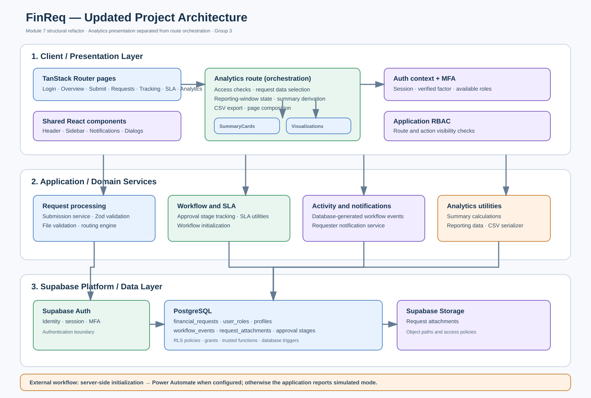
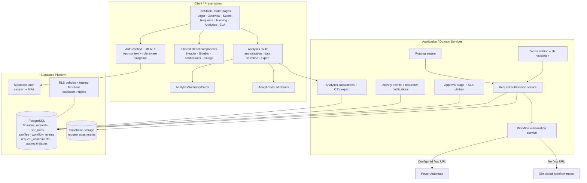

# FinReq Architecture

**Project:** Financial Request Management System (FinReq)  
**Team:** Group 3  
**Architecture baseline:** Updated for Module 7  
**Refactor focus:** Separate analytics presentation from route orchestration

## Architecture diagram

The diagram is also available as an editable Mermaid view below.

## End-to-end request flow

1. A user opens a route in the React/TanStack application. Supabase Auth manages the user session and MFA state.
2. The client validates request fields and supported attachments for immediate feedback. Authorization is checked in the application for user experience, while Supabase Row Level Security and database grants enforce data access at the database boundary.
3. The submission service coordinates request persistence, attachment storage, routing metadata, and workflow initialization. The routing engine selects the configured approval path.
4. PostgreSQL stores financial request and workflow state. Database triggers and trusted functions write activity records to `workflow_events`; requester status notifications are stored separately and scoped to their recipient.
5. Workflow initialization calls Power Automate only when a server-side flow URL is configured. Without that configuration, the application reports simulated mode; simulation is not evidence of external delivery.
6. The analytics route selects request data, calculates dashboard summary values, and controls CSV export. Its visual components now render summary cards and charts without owning data fetching or authorization logic.

## Module 7 refactor

### Architectural issue

Before this refactor, `src/routes/analytics.tsx` mixed route concerns (authorization, data selection, reporting-window state, and CSV export) with the detailed JSX and Recharts configuration for KPI cards and three visualizations. This made a route-level file responsible for orchestration and reusable presentation details.

### Refactor

- Added `src/components/analytics/AnalyticsSummaryCards.tsx` to render KPI cards from typed label/value data.
- Added `src/components/analytics/AnalyticsVisualizations.tsx` to render request volume, funding distribution, and approval-turnaround charts from props.
- Updated `src/routes/analytics.tsx` to coordinate access, data selection, summary calculation, reporting-window state, and CSV export, then compose the two presentation components.
- Kept the input data sources, labels, chart settings, and displayed values unchanged. This is a structural refactor, not a change to analytics policy or reporting logic.

### Responsibility boundaries after refactor

| Layer | Responsibility |
|---|---|
| Route | Authorization, data selection, reporting-window state, summary derivation, CSV export, page composition |
| AnalyticsSummaryCards | Presentational KPI cards |
| AnalyticsVisualizations | Presentational charts |
| analytics-utils | Pure summary and reporting-window calculations |
| requests-data | Loads request data from Supabase and current fallback paths |
| mock-data | Existing placeholder chart/request data (still a known follow-up concern) |

## Security and environment boundaries

- Client-side route checks control navigation and presentation; they are not a substitute for database authorization.
- Supabase RLS and database grants remain the authoritative data-access controls.
- Publishable Supabase keys are client-side configuration; service-role keys must remain server-side secrets.
- Power Automate delivery is environment-dependent. A simulated workflow is not an external delivery.
- Analytics still has mock-data fallbacks and a hardcoded turnaround KPI in the current implementation. Those data-validity issues are deliberately not changed by this presentation-only refactor and should be prioritized separately.

## Verification record

The refactor is intended to preserve existing behavior. Verify before merging:

- `npm test`
- `npx tsc --noEmit`
- `npm run lint` (or the repository's changed-file lint command if available)
- `npm run build`
- Manual browser check of /analytics for Week, Month, and Quarter selection, charts, and CSV export.

The branch's pull request should record the actual commands and results run by the contributor/CI. Do not mark a check as passed unless it has actually run.

## Source references

- `src/routes/analytics.tsx`
- `src/lib/analytics-utils.ts`
- `src/lib/requests-data.ts`
- `src/lib/mock-data.ts`
- `src/lib/rbac.ts`
- `src/lib/requests/submission-service.ts`
- `src/lib/routing/engine.ts`
- `src/lib/workflow/initialize-workflow.ts`
- `src/lib/sla-utils.ts`
- `src/lib/requester-notifications.ts`
- `supabase/migrations/`
- `docs/DEBT_AND_RISK.md`
